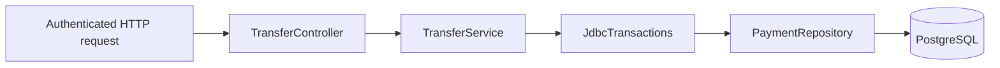

# Payment Transfer Service — Java 21 / Micronaut

A small banking transfer API with server-side authorization, exact money arithmetic, atomic PostgreSQL transactions, persistent idempotency and a balanced audit ledger.

The implementation uses Micronaut constructor injection with controller, service, domain and JDBC persistence boundaries.

## Build and test

Install JDK 21, then run:

```sh
./mvnw verify
```

The Maven wrapper downloads Maven. Tests start a temporary **real PostgreSQL 17** instance using Embedded Postgres, run the Flyway migration, and start the actual Micronaut HTTP server. They require neither Docker nor an existing database. Run tests as a regular user: PostgreSQL refuses to initialize as root. Linux/macOS x64 and arm64 are configured; first use downloads platform binaries.

`verify` runs JUnit tests, packages the application and checks Java formatting. To apply formatting after edits:

```sh
./mvnw spotless:apply
```

Versions are pinned in `pom.xml`: Java 21, Micronaut 4.10.23, Embedded Postgres 2.2.2, and PostgreSQL test binaries 17.11.0. Micronaut manages the application dependency versions. The current Micronaut platform BOM emits an upstream warning about a duplicate Flexmark dependency-management entry; Flexmark is not an application dependency.

## Run locally

Requires Docker Compose for the example database, or an existing PostgreSQL instance. Use a strong local password and JWT secret in the same shell used to launch the application:

```sh
export JDBC_PASSWORD="$(openssl rand -hex 24)"
export JWT_SECRET="$(openssl rand -hex 32)"
docker compose up -d --wait
./mvnw mn:run
```

For a database that already exists, configure `JDBC_URL`, `JDBC_USER` and `JDBC_PASSWORD`. Defaults are `jdbc:postgresql://localhost:5432/payments` and user `payments`. The password and JWT secret have **no defaults**. Flyway creates the schema at startup. Retain the database password between restarts; generating a new environment value does not change a password stored in an existing Docker volume.

After the app has started, in another terminal at the project directory, provision the development fixtures:

```sh
docker compose exec -T postgres psql -U payments -d payments < scripts/seed-demo.sql
```

The shell used for Compose must retain the same `JDBC_PASSWORD`. The following example commands also need the **same `JWT_SECRET`** as the server. The helper issues a 15-minute development token; normal deployments use a trusted identity provider.

```sh
TOKEN=$(python3 scripts/demo-token.py alice)
KEY=$(python3 -c 'import uuid; print(uuid.uuid4())')

curl -i http://localhost:8080/transfers \
  -H "Authorization: Bearer $TOKEN" \
  -H "Idempotency-Key: $KEY" \
  -H 'Content-Type: application/json' \
  -d '{
    "sourceAccountId": "00000000-0000-0000-0000-000000000001",
    "destinationAccountId": "00000000-0000-0000-0000-000000000002",
    "amount": 25.00,
    "currency": "USD"
  }'
```

Alice's source starts with USD 1,000.00; Bob's recipient starts with USD 250.00. The result is USD 975.00 and USD 275.00. Repeating the exact request with the **same key** returns the existing receipt and does not move money again. The seed script does not reset existing balances.

The response contains a `Location` header. Fetch the receipt using the initiating user's token:

```sh
curl -H "Authorization: Bearer $TOKEN" http://localhost:8080/transfers/TRANSFER_ID
```

## API contract

| Endpoint / outcome | Response |
| --- | --- |
| `POST /transfers` — first successful request | `201 Created`, receipt, `Location`, `Idempotency-Replayed: false` |
| Same principal + key + normalized details | `200 OK`, original receipt, `Idempotency-Replayed: true` |
| Same principal + key, different details | `409 IDEMPOTENCY_CONFLICT` |
| Missing/malformed fields or invalid amount | `400 Bad Request` |
| Missing, expired, invalid or incorrectly scoped JWT | `401 Unauthorized` |
| Unknown source or source owned by someone else | `404 SOURCE_UNAVAILABLE` |
| Insufficient funds, currency mismatch or recipient balance overflow | `422`, specific domain code |
| Unknown recipient | `422 DESTINATION_UNAVAILABLE` |
| Database error, lock timeout or uncertain commit outcome | `503 SERVICE_UNAVAILABLE`, `Retry-After: 1` |
| `GET /transfers/{id}` — initiated by this user | `200 OK`, receipt |
| Unknown receipt or another user's receipt | `404 TRANSFER_NOT_FOUND` |

Business errors use `{"code":"INSUFFICIENT_FUNDS","message":"Source account has insufficient funds."}`. JSON binding, validation and authentication failures use Micronaut's standard error response. Internal SQL messages and exception traces are not returned to callers. Application database failure logs contain SQLSTATE only.

`Idempotency-Key` is a UUID. Clients must persist it with the request before sending and reuse it after timeouts or `503` responses. Keys are scoped to the authenticated principal and retained with successful transfers. Rejected, rolled-back commands do not reserve a key. Numerically equivalent amounts such as `25` and `25.00` match the same committed request. A new key denotes a new transfer.

Amounts are parsed as `BigDecimal`, checked without rounding, then converted exactly to signed 64-bit minor units. Supported currencies are USD, EUR and GBP, each with two decimal places. The maximum is `92233720368547758.07`; zero, negative, excess precision and overflow are rejected. Transfers never convert currencies. Recipient balances cannot exceed the same bound.

## Architecture and transaction design



- **Controller:** binds and validates input, derives identity from Micronaut's authenticated principal, and maps successful HTTP outcomes. JDBC work runs on the blocking executor, away from the Netty event loop.
- **Domain:** immutable Java records, supported currencies, exact amount conversion and typed errors.
- **Service:** revalidates commands independently of HTTP, checks authorization and funds, and coordinates a single database transaction.
- **Persistence:** prepared JDBC statements use the same explicitly passed connection throughout the transaction. No connection is shared between requests. Flyway owns schema changes.

Within one `READ COMMITTED` transaction:

1. Take a PostgreSQL transaction-scoped advisory lock for the principal/key pair, then check for an existing transfer. Hash collisions can delay unrelated keys but cannot corrupt their identity; a unique database constraint remains authoritative.
2. Lock both account rows using `ORDER BY id FOR UPDATE`. A common ordering prevents opposite-direction transfers from taking locks in conflicting order. This works across service instances, not only threads in one JVM.
3. Check source ownership, account existence, currency, funds and destination overflow against the **locked current balances**.
4. Update both balances and insert the transfer plus equal-and-opposite ledger postings.
5. Commit. PostgreSQL's deferred constraint triggers verify that the transfer has exactly the two correct postings, including account, currency and amount. Failure anywhere rolls back both balances and every audit write.

Account constraints prohibit negative balances. Audit rows contain the authenticated initiator, idempotency key, transfer ID, accounts, amount, currency, UTC timestamp and post-transfer balances. Public receipts omit the recipient's balance. Update/delete triggers protect audit rows against ordinary mutations; database owners can still alter schema or truncate tables, so this is not a tamper-proof external audit archive.

Idempotency locks are taken before account locks. Database waits are bounded by a three-second lock timeout, five-second statement timeout and five-second pool connection timeout. An uncertain commit is never retried with a new key automatically. A client retry reconciles against the committed row.

## Authentication and deployment boundary

Micronaut verifies HS256 JWT signatures, expiry, issuer (`payment-issuer` by default), audience (`payment-transfer` by default), and subject. An additional validator requires an expiration claim and a nonblank subject. The subject is the account owner identifier. A `userId` field in JSON cannot change it. There is no login endpoint or hard-coded application credential.

For deployment, supply the bank's trusted issuer integration (typically asymmetric JWT/JWKS), terminate TLS, and use a restricted application database role separate from the migration owner. The local token helper and fixture script are development tools. Account provisioning, FX, reversals, fees, notifications and a durable client retry outbox are outside this basic service. Balances are authoritative in PostgreSQL; no client-provided balance is accepted.

## Verification coverage

Verified with the included Maven wrapper on Java 21.0.13 and PostgreSQL 17.11: **52 tests, zero failures, zero skipped**. Packaging and Spotless formatting checks pass.

Tests exercise exact amount limits, service-side validation, ownership, missing accounts, currency mismatch, insufficient funds and overflow; persistence and principal-scoped idempotency; append-only audit rows; a failed second posting and a failed deferred commit; concurrent spending, duplicate keys, conflicting keys and opposite-direction transfers; HTTP status mapping, safe storage errors, JWT signature/expiry/issuer/audience checks, and receipt isolation.

Tests coordinate concurrent requests with a latch rather than sleeps. Separate service objects and pooled connections share PostgreSQL, so a passing concurrency test cannot be explained by a Java `synchronized` block. No tests are skipped when Docker is unavailable.

Framework references: [Micronaut 4.10 documentation](https://docs.micronaut.io/4.10.x/), [Micronaut Security](https://docs.micronaut.io/4.10.x/security/), [Embedded Postgres](https://github.com/zonkyio/embedded-postgres).
